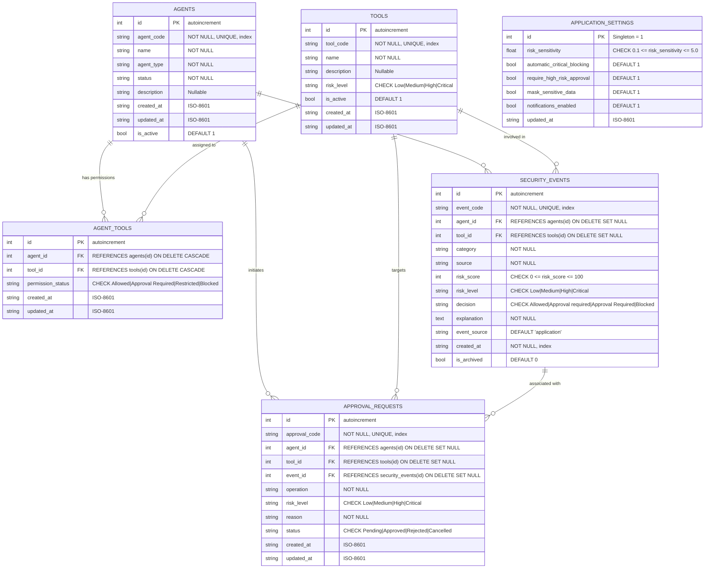

# Shield AI — AI Agent Security Shield

**Secure Every Prompt. Control Every Action. Trust Every Agent.**

Full-Stack Implementation (DecodeLabs Projects 1, 2, 3 & 4): Responsive UI frontend paired with a high-performance **Python + FastAPI + SQLAlchemy ORM 2.x + SQLite** backend REST API gateway with relational persistence, Alembic database migrations, and **complete asynchronous frontend-backend integration**.

---

## 1. Quick Start Guide (Windows)

### Prerequisites
- Python 3.10+ (tested on Python 3.14.3)
- PowerShell or Command Prompt
- Modern web browser (Chrome, Edge, Firefox, Safari)

### Step 1: Create and Activate Virtual Environment
```powershell
# Navigate to the project root directory
cd C:\Users\navne\Downloads\shield-ai

# Create virtual environment
python -m venv .venv

# Activate virtual environment (PowerShell)
.\.venv\Scripts\Activate.ps1
```

### Step 2: Install Backend Dependencies
```powershell
pip install -r backend/requirements.txt
```

### Step 3: Run Alembic Database Migrations
The database schema is managed through Alembic migrations:
```powershell
alembic upgrade head
```
*(Note: When the application starts, it also verifies and ensures schema initialization automatically).*

### Step 4: Run the Full-Stack Application
```powershell
uvicorn backend.app.main:app --reload --host 127.0.0.1 --port 8000
```

### Step 5: Open in Your Browser
- **Integrated Full-Stack Application**: [http://127.0.0.1:8000](http://127.0.0.1:8000)
- **API Health Check**: [http://127.0.0.1:8000/api/health](http://127.0.0.1:8000/api/health)
- **Interactive OpenAPI Documentation (Swagger UI)**: [http://127.0.0.1:8000/docs](http://127.0.0.1:8000/docs)
- **ReDoc Documentation**: [http://127.0.0.1:8000/redoc](http://127.0.0.1:8000/redoc)

---

## 2. Project 4 Full-Stack Integration Architecture

DecodeLabs Project 4 establishes the complete, production-ready integration bridge connecting the responsive HTML5/CSS3/Vanilla JS frontend with the FastAPI REST gateway and SQLAlchemy/SQLite persistence layer.

```
┌──────────────────────────────────────────────────────────────────────────────────┐
│                      COMPLETE FULL-STACK LIFECYCLE FLOW                          │
├─────────────────────┬──────────────────────────┬─────────────────────────────────┤
│   1. USER INPUT     │       2. PROCESS         │           3. OUTPUT             │
│ (Frontend Action)   │   (FastAPI + SQLite)     │      (Dynamic DOM Update)       │
├─────────────────────┼──────────────────────────┼─────────────────────────────────┤
│ • Prompt Submission │ • Syntactic Validation   │ • Status badge & Risk score     │
│ • Tool Perm Toggle  │ • Heuristic Engine Scan  │ • Masked sensitive data preview │
│ • Approval Decision │ • Policy Hierarchy Check │ • Verified server notification  │
│ • Attack Simulation │ • ACID DB Transaction    │ • Proportional SVG bar chart    │
│ • Log Search Filter │ • Structured JSON Emit   │ • Table re-render without reload│
└─────────────────────┴──────────────────────────┴─────────────────────────────────┘
```

### Core Full-Stack Integration Features

1. **Centralized Fetch API Client (`js/api.js`)**:
   - Single point of HTTP communication using clean `async`/`await` patterns.
   - Built-in `AbortController` timeout (15s default) guarding against hung network connections.
   - Automatic JSON serialization and header management (`Accept: application/json`, `Content-Type: application/json`).
   - Safe parsing handling HTTP 204 No Content without attempting JSON deserialization.
   - Accurate content-type inspection before response parsing.

2. **Comprehensive HTTP Status Code Handling**:
   | Status Code | Classification | Frontend Handling |
   |---|---|---|
   | **200 OK** | Success | Parses payload and dynamically renders view |
   | **201 Created** | Resource Created | Renders created entity & triggers background counter update |
   | **204 No Content** | Empty Success | Handles success cleanly without JSON parsing |
   | **400 Bad Request** | Gatekeeper Error | Displays user-friendly validation explanation |
   | **401 Unauthorized** | Auth Failure | Prompts for credentials where required |
   | **403 Forbidden** | Policy Denied | Explains permission denial |
   | **404 Not Found** | Missing Entity | Displays descriptive not-found notice |
   | **409 Conflict** | State Conflict | Alerts user that entity (e.g. approval) was already resolved |
   | **422 Unprocessable** | Pydantic Error | Formats field-level schema validation errors |
   | **429 Rate Limited** | Throttling | Warns user to pause before submitting more requests |
   | **500 Server Error** | Internal Failure | Sanitized message shown; internal trace never exposed |
   | **502 / 503 / 504** | Gateway Offline | Warns that backend server is unreachable with retry option |

3. **Asynchronous Best Practices**:
   - Parallel initial data hydration via `Promise.allSettled([loadSettings(), loadTools(), loadAgents(), loadApprovals(), loadLogs(), loadDashboard()])`.
   - Debounced threat log search (300ms) with `AbortController` signal cancellation to abort obsolete in-flight requests when users type rapidly.
   - Reactive cross-module refreshes: scans, approvals, permission changes, and simulations automatically update the Dashboard KPIs, Activity timeline, and Threat logs.

4. **Defensive UI States & Safe Rendering**:
   - **Loading State**: Visual loading indicators and button disablers during in-flight mutations.
   - **Success State**: Verified server responses rendered with color-coded risk/decision pills (`ok`, `warn`, `bad`).
   - **Empty State**: Clear explanatory messages when filter criteria yield 0 records.
   - **Error State**: Non-blocking toast notifications and inline retry banners.
   - **Safe DOM Rendering**: All user and backend strings pass through `esc()` to prevent DOM-based XSS vulnerabilities.

5. **CORS & Origin Security**:
   - Same-origin deployment: Frontend assets (`/css`, `/js`, `/assets`, `index.html`) served directly by FastAPI.
   - Cross-origin development supported via `CORSMiddleware` configured for standard development ports (`:3000`, `:5500`, `:8000`, `:8080`, `:5173`), handling preflight `OPTIONS` requests and returning `Access-Control-Allow-Origin` headers.

---

## 3. The Eight Unified Full-Stack Modules

| Module | User Interaction (Input) | Backend Processing | Verified UI Output |
|---|---|---|---|
| **1. Overview Dashboard** | View load or tab switch | Aggregates DB events, risk distribution, timeline bins | 4 dynamic KPI cards, proportional SVG chart, recent events |
| **2. Prompt Scanner** | Submit prompt or click sample | Gatekeeper length check, heuristic scanning, PII masking | Classification pill, score /100, masked PII, server explanation |
| **3. Agent Monitor** | Select agent profile | Queries agent profile and execution pipeline | 9 workflow stages, proposed action, policy decision badge |
| **4. Tool Permissions** | Toggle switch or change dropdown | Validates status enum, persists to SQLite `agent_tools` | Confirmed status badge, server toast, rolls back on error |
| **5. Approval Center** | Click "Approve" or "Reject" | Validates pending state, writes decision & audit event | Disables buttons, updates row status pill, prevents 409 conflict |
| **6. Threat Logs** | Type search or pick filter | Parameterized SQL query across categories, severity, decision | Dynamic table render, record count, modal event inspection |
| **7. Attack Simulator** | Pick scenario & run simulation | Evaluates policy hierarchy (*strictest wins*), creates event | Multi-stage visual workflow, decision banner, audit code |
| **8. Settings** | Adjust sensitivity slider & toggles | Enforces CHECK constraints (0.1–5.0), saves to SQLite | Verified confirmation toast, persists across page reloads |

---

## 4. Database Schema Specification (SQLAlchemy ORM 2.x)



---

## 5. Automated Testing Verification

Run the complete automated test suite (57 tests):

```powershell
python -m pytest backend/tests -v
```

### Verified Test Results (57 Passed in 4.43s):
- **Full-Stack Integration**: `test_fullstack_integration.py` (CORS headers & preflight OPTIONS, 8-module end-to-end flow, Gatekeeper error status codes) — **3 PASSED**
- **Alembic Migrations**: `test_migrations.py` (Fresh DB creation, rollback & re-upgrade, Project 2 data preservation, DB constraints) — **4 PASSED**
- **Model Constraints & Foreign Keys**: `test_models_and_schema.py` (CHECK constraint enforcement, foreign key referential integrity, UNIQUE constraints) — **5 PASSED**
- **Complete CRUD Operations**: `test_crud_operations.py` (Full CRUD across Agents, Tools, AgentTools, Events, Approvals) — **5 PASSED**
- **Relational Integrity**: `test_relationships.py` (1:M cascades, M:M junction tables, cascade deletes) — **3 PASSED**
- **SQL Injection Defense**: `test_sql_injection.py` (Parameterized query safety on searches and inserts) — **2 PASSED**
- **System Health**: `test_health.py` (Health check and root HTML serving) — **2 PASSED**
- **Prompt Scanner**: `test_scanner.py` (Injection detection, PII masking, length bounds) — **5 PASSED**
- **Permissions**: `test_permissions.py` (Matrix operations, validation, reset) — **6 PASSED**
- **Approval Workflow**: `test_approvals.py` (State transitions, duplicate prevention, conflicts) — **5 PASSED**
- **Audit Logs**: `test_events.py` (Search filters, pagination, category selection) — **4 PASSED**
- **Attack Simulator**: `test_simulator.py` (Multi-stage execution, policy evaluation) — **4 PASSED**
- **Persistence**: `test_persistence.py` (Settings updates, database persistence across calls) — **5 PASSED**
- **Contract Integration**: `test_integration.py` (Static file mounting, end-to-end API workflows) — **4 PASSED**

---

## 6. Project Directory Structure

```
shield-ai/
├── index.html                  # Semantic HTML5 shell and 8 modular views
├── css/
│   ├── style.css               # Mobile-first design system, design tokens, interactive states
│   └── responsive.css          # Fluid layout breakpoints (320px to 1440px+)
├── js/
│   ├── api.js                  # Centralized Fetch API client (timeouts, errors, CORS, status codes)
│   └── app.js                  # Asynchronous UI controller, DOM manipulation, state management
├── data/
│   └── shield_ai.db            # Persistent SQLite database (normalized 3NF)
├── alembic.ini                 # Alembic migration configuration
├── backend/
│   ├── requirements.txt        # Backend dependencies (FastAPI, SQLAlchemy, Alembic)
│   ├── migrations/             # Alembic migration revisions
│   │   ├── env.py              # Dynamic DB connection runner
│   │   ├── script.py.mako
│   │   └── versions/
│   │       └── c569f299eaed_create_project3_relational_schema.py
│   ├── app/
│   │   ├── __init__.py
│   │   ├── main.py             # FastAPI entrypoint, CORS middleware, static mounting
│   │   ├── exceptions.py       # Gatekeeper standard error handling
│   │   ├── database/           # SQLAlchemy 2.0 shared engine & session factory
│   │   ├── models/             # SQLAlchemy ORM Relational Models (6 tables)
│   │   ├── schemas/            # Pydantic Validation & Serialization Schemas
│   │   ├── repositories/       # SQLAlchemy 2.0 Data Access Repositories
│   │   ├── routes/             # REST API Route Controllers
│   │   └── services/           # Heuristic security & policy evaluation engines
│   └── tests/                  # Pytest Automated Test Suite (57 Tests)
│       ├── conftest.py
│       ├── test_fullstack_integration.py # Project 4 complete integration tests
│       ├── test_migrations.py            # Alembic schema & preservation tests
│       ├── test_models_and_schema.py
│       ├── test_crud_operations.py
│       ├── test_relationships.py
│       ├── test_sql_injection.py
│       ├── test_health.py
│       ├── test_scanner.py
│       ├── test_permissions.py
│       ├── test_approvals.py
│       ├── test_events.py
│       ├── test_simulator.py
│       ├── test_persistence.py
│       └── test_integration.py
└── README.md
```
