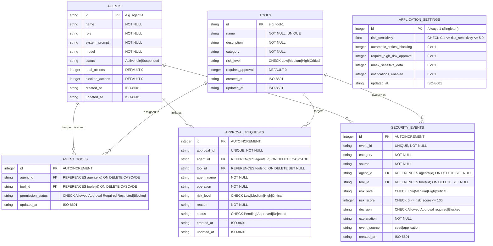

# Shield AI — AI Agent Security Shield

**Secure Every Prompt. Control Every Action. Trust Every Agent.**

Full-Stack Implementation (DecodeLabs Projects 1, 2 & 3): Responsive UI frontend paired with a high-performance **Python + FastAPI + SQLAlchemy ORM 2.x + SQLite** backend REST API gateway with relational persistence, Alembic database migrations, and comprehensive CRUD capabilities.

---

## 1. Quick Start Guide (Windows)

### Prerequisites
- Python 3.10+ (tested on Python 3.14.3)
- PowerShell or Command Prompt

### Step 1: Create and Activate Virtual Environment
```powershell
# Navigate to the project root directory
cd C:\Users\navne\Downloads\shield-ai

# Create virtual environment
python -m venv .venv

# Activate virtual environment (PowerShell)
.\.venv\Scripts\Activate.ps1
```

### Step 2: Install Backend Dependencies
```powershell
pip install -r backend/requirements.txt
```

### Step 3: Run Alembic Database Migrations
The database schema can be created or updated using Alembic migrations:
```powershell
alembic upgrade head
```
*(Note: The application also verifies and initializes tables automatically upon startup via SQLAlchemy declarative metadata and idempotent migration routines).*

### Step 4: Run the Application
```powershell
uvicorn backend.app.main:app --reload --host 127.0.0.1 --port 8000
```

### Step 5: Open in Your Browser
- **Integrated Application**: [http://127.0.0.1:8000](http://127.0.0.1:8000)
- **API Health Check**: [http://127.0.0.1:8000/api/health](http://127.0.0.1:8000/api/health)
- **Interactive OpenAPI Documentation (Swagger UI)**: [http://127.0.0.1:8000/docs](http://127.0.0.1:8000/docs)
- **ReDoc Documentation**: [http://127.0.0.1:8000/redoc](http://127.0.0.1:8000/redoc)

---

## 2. Project 3 Architectural Pillars

DecodeLabs Project 3 establishes the four foundational pillars of enterprise database persistence:

```
┌────────────────────────────────────────────────────────────────────────┐
│                        SHIELD AI ARCHITECTURE                          │
├──────────────────┬──────────────────┬──────────────────┬───────────────┤
│    BLUEPRINT     │      BRIDGE      │      ACTION      │    SHIELD     │
│ (Schema & Design)│  (ORM & Drivers) │  (CRUD & HTTP)   │  (Integrity)  │
├──────────────────┼──────────────────┼──────────────────┼───────────────┤
│ • Normalized 3NF │ • SQLAlchemy 2.0 │ • POST -> INSERT │ • Foreign Keys│
│ • 6 Core Tables  │ • SessionFactory │ • GET  -> SELECT │ • CHECK rules │
│ • 1:M & M:M Rel. │ • Engine Pooling │ • PUT  -> UPDATE │ • Param Queries│
│ • Alembic Migr.  │ • PRAGMA FK Enfc │ • DEL  -> DELETE │ • ORM Typing  │
└──────────────────┴──────────────────┴──────────────────┴───────────────┘
```

1. **Blueprint (Schema and Design)**: Strict relational schema normalized to 3NF, modeling AI agents, tool catalogs, authorization mappings, security audits, approval queues, and application policies.
2. **Bridge (Integration and Connection)**: SQLAlchemy 2.0 ORM serving as the modern abstraction layer over SQLite, complete with session management, connection pooling, and connection listeners enforcing SQLite foreign key constraints (`PRAGMA foreign_keys=ON;`).
3. **Action (CRUD and RESTful HTTP)**: Every relational entity maps standard REST verbs directly to relational SQL operations with proper HTTP status codes (`200 OK`, `201 Created`, `204 No Content`, `400 Bad Request`, `404 Not Found`, `409 Conflict`).
4. **Shield (Integrity and Security)**: Database-level domain integrity via NOT NULL, UNIQUE, and CHECK constraints (e.g., risk score 0–100, sensitivity 0.1–5.0), referential cascading, and 100% defense against SQL Injection via bound parameterized statements.

---

## 3. Database Selection Justification

### SQL (Relational) vs. NoSQL (Non-Relational)
| Criteria | Relational (SQL) | Document/NoSQL | Shield AI Justification |
|---|---|---|---|
| **Data Structure** | Rigid, normalized tables with schemas | Flexible, schemaless JSON documents | Security audit logs, policies, and permissions require strict types and deterministic schemas. |
| **Referential Integrity** | Enforced at DB engine level via Foreign Keys | Handled in application code; orphan records possible | A tool permission cannot exist without an agent and a tool; DB must enforce this constraint. |
| **ACID Compliance** | Immediate consistency & transaction atomicity | Eventual consistency; relaxed ACID guarantees | Security state changes (approvals, blocks) must be immediate and atomic across the entire system. |
| **Query Flexibility** | Powerful joins, aggregations, relational projections | Simple key-value or document-level queries | Timeline aggregation, multi-agent risk calculations, and joined audits require efficient SQL joins. |

### Why SQLite with SQLAlchemy 2.0 ORM?
1. **Zero-Configuration Deployment**: Self-contained, serverless engine that requires no external database daemons, perfect for lightweight enterprise edge gateways and local environments.
2. **Full Relational Capabilities**: Supports ACID transactions, foreign keys, table constraints, indices, and triggers.
3. **ORM Modernization**: Utilizing SQLAlchemy 2.0 `DeclarativeBase` and `mapped_column` allows future transition to PostgreSQL or MySQL with zero application code changes—only the connection string changes (`postgresql+psycopg2://...`).

### When to Transition to an Enterprise RDBMS (e.g., PostgreSQL)?
- **High Concurrency & Parallel Writes**: When multiple autonomous agent worker threads execute concurrent write transactions that exceed SQLite's file-locking concurrency.
- **Role-Based DB Access**: When database-native connection authentication and fine-grained user table permissions are required.
- **Advanced Indexing & Partitioning**: When security audit logs grow into millions of records requiring time-series partitioning and specialized full-text search indexes.

---

## 4. Database Schema Specification & Constraints

Shield AI implements 6 normalized relational tables inside `data/shield_ai.db`.



### 1:1 Relationship Architectural Analysis
In relational architecture, **One-to-One (1:1)** relationships occur when exactly one record in Table A relates to at most one record in Table B (enforced by a `UNIQUE` foreign key). 
In Shield AI, core agent attributes and settings are stored directly in their respective tables to avoid unnecessary join overhead. An artificial 1:1 table was intentionally not forced. However, in enterprise extensions, a natural 1:1 relationship would model an `AgentSecurityProfile` or `AgentCredentialVault` linked to `agents(id)`:
```
agents (1) ── (1) agent_security_profiles (holds hardware enclave keys & cryptographic identity)
```

---

## 5. Complete CRUD API Reference

| Resource | HTTP Method | Endpoint | SQL Action | Description | Status Codes |
|---|---|---|---|---|---|
| **Agents** | `GET` | `/api/agents` | `SELECT` | List all registered agents with active tool count | 200 |
| | `POST` | `/api/agents` | `INSERT` | Register a new autonomous agent | 201, 400, 409 |
| | `GET` | `/api/agents/{id}` | `SELECT` | Fetch single agent profile details | 200, 404 |
| | `PUT` | `/api/agents/{id}` | `UPDATE` | Update agent configuration and status | 200, 400, 404 |
| | `DELETE` | `/api/agents/{id}` | `DELETE` | Remove agent and cascade tool mappings | 204, 404 |
| | `GET` | `/api/agents/{id}/activity` | `SELECT` | Agent telemetry and execution pipeline | 200, 404 |
| **Tools** | `GET` | `/api/tool-catalog` | `SELECT` | List all tools in security catalog | 200 |
| | `POST` | `/api/tool-catalog` | `INSERT` | Register a new capability tool | 201, 400, 409 |
| | `GET` | `/api/tool-catalog/{id}` | `SELECT` | Fetch single tool metadata | 200, 404 |
| | `PUT` | `/api/tool-catalog/{id}` | `UPDATE` | Update tool metadata and baseline risk | 200, 400, 404 |
| | `DELETE` | `/api/tool-catalog/{id}` | `DELETE` | Delete tool from catalog | 204, 404 |
| **Agent Tools** | `GET` | `/api/agents/{id}/tools` | `SELECT` | List assigned tools for a specific agent | 200, 404 |
| | `POST` | `/api/agents/{id}/tools` | `INSERT` | Assign tool to agent with permission | 201, 400, 404, 409 |
| | `PUT` | `/api/agents/{aid}/tools/{tid}` | `UPDATE` | Update agent-specific tool permission | 200, 400, 404 |
| | `DELETE` | `/api/agents/{aid}/tools/{tid}` | `DELETE` | Revoke tool permission from agent | 204, 404 |
| | `GET` | `/api/tools` | `SELECT` | Frontend-compatible flattened tool permission matrix | 200 |
| | `PUT` | `/api/tools/{tool_id}` | `UPDATE` | Update tool permission status | 200, 400, 404 |
| | `POST` | `/api/tools/reset` | `UPDATE` | Reset tool permissions to baseline | 200 |
| **Events** | `GET` | `/api/events` | `SELECT` | Filter and paginate security audit events | 200 |
| | `POST` | `/api/events` | `INSERT` | Manually log security event audit entry | 201, 400 |
| | `GET` | `/api/events/{event_id}` | `SELECT` | Retrieve single audit event record | 200, 404 |
| | `DELETE` | `/api/events/{event_id}` | `DELETE` | Delete audit event record | 204, 404 |
| **Approvals** | `GET` | `/api/approvals` | `SELECT` | List approval requests (filter by `status`) | 200 |
| | `POST` | `/api/approvals` | `INSERT` | Submit high-risk operation for approval | 201, 400, 404 |
| | `GET` | `/api/approvals/{id}` | `SELECT` | Fetch approval request details | 200, 404 |
| | `POST` | `/api/approvals/{id}/decision` | `UPDATE` | Approve or reject pending request | 200, 400, 404, 409 |
| | `DELETE` | `/api/approvals/{id}` | `DELETE` | Cancel or purge approval request | 204, 404 |
| **Settings** | `GET` | `/api/settings` | `SELECT` | Retrieve active policy thresholds | 200 |
| | `PUT` | `/api/settings` | `UPDATE` | Update security policy thresholds | 200, 400 |
| | `POST` | `/api/demo/reset` | `UPDATE` | Restore initial demonstration seed state | 200 |
| **Scanner & Sim**| `POST` | `/api/scans` | `INSERT` | Analyze prompt, detect threats, log event | 200, 400 |
| | `POST` | `/api/simulations` | `INSERT` | Run attack simulation & evaluate policy | 200, 400 |
| **Dashboard** | `GET` | `/api/dashboard` | `SELECT` | Aggregated security metrics & risk timeline | 200 |
| **Health** | `GET` | `/api/health` | `SELECT 1` | System health and database connection test | 200 |

---

## 6. Database Integrity & SQL Injection Defense

### Database-Level Constraints Enforced
1. **Foreign Key Integrity**: Enforced via SQLite connection hook (`PRAGMA foreign_keys=ON;`). Deleting an agent cascades and cleans up `agent_tools`, while setting `agent_id` to NULL in historical security events.
2. **CHECK Constraints**:
   - `ck_tool_risk_level`: `risk_level IN ('Low', 'Medium', 'High', 'Critical')`
   - `ck_agent_tool_permission`: `permission_status IN ('Allowed', 'Approval Required', 'Restricted', 'Blocked')`
   - `ck_security_event_score`: `risk_score >= 0 AND risk_score <= 100`
   - `ck_security_event_level`: `risk_level IN ('Low', 'Medium', 'High', 'Critical')`
   - `ck_security_event_decision`: `decision IN ('Allowed', 'Approval required', 'Blocked')`
   - `ck_approval_risk_level`: `risk_level IN ('Low', 'Medium', 'High', 'Critical')`
   - `ck_approval_status`: `status IN ('Pending', 'Approved', 'Rejected')`
   - `ck_settings_sensitivity`: `risk_sensitivity >= 0.1 AND risk_sensitivity <= 5.0`
3. **UNIQUE Constraints**:
   - `tools.name`: Tool catalog names must be unique.
   - `agent_tools(agent_id, tool_id)`: Composite uniqueness ensures no duplicate tool assignments per agent.
   - `security_events.event_id`: Unique audit event reference.
   - `approval_requests.approval_id`: Unique approval identifier.

### SQL Injection Immunity
All database interactions use **SQLAlchemy ORM 2.x parameterized statements** (`session.execute(select(...).where(...))`). User input is treated strictly as bound parameters and is never concatenated directly into SQL strings:
```python
# SECURE: Automatically compiled into bound parameterized SQL
stmt = select(Tool).where(Tool.id == tool_id)
result = db.scalars(stmt).first()
```
Even when searching audit logs with raw text containing quotes or SQL syntax (e.g. `' OR '1'='1`), input is safely bound as literal text parameters.

---

## 7. Alembic Database Migrations

Alembic manages schema evolution and version tracking.

### Migration Commands (PowerShell)
```powershell
# Apply all pending migrations to the latest revision
alembic upgrade head

# Roll back the most recent migration
alembic downgrade -1

# Create a new automated migration revision after modifying models
alembic revision --autogenerate -m "describe_schema_change"

# View current revision history
alembic history --verbose

# Check current database revision head
alembic current
```

---

## 8. Automated Testing & Verification

The test suite contains 50 automated tests executing against an isolated temporary SQLite database, verifying model constraints, relationships, complete CRUD endpoints, SQL injection defense, and frontend integration.

```powershell
python -m pytest backend/tests -v
```

### Verified Test Results (50 Passed in 11.82s):
- **Model Constraints & Foreign Keys**: `test_models_and_schema.py` (CHECK constraint enforcement, foreign key referential integrity, UNIQUE constraints) — **PASSED**
- **Complete CRUD Operations**: `test_crud_operations.py` (Full CRUD across Agents, Tools, AgentTools, Events, Approvals) — **PASSED**
- **Relational Integrity**: `test_relationships.py` (1:M cascades, M:M junction tables, cascade deletes) — **PASSED**
- **SQL Injection Defense**: `test_sql_injection.py` (Malicious SQL input in queries, search fields, and parameter bounds) — **PASSED**
- **System Health**: `test_health.py` (Health check and root serving) — **PASSED**
- **Prompt Scanner**: `test_scanner.py` (Prompt injection, PII masking, length validation) — **PASSED**
- **Permissions**: `test_permissions.py` (Matrix operations, validation, reset) — **PASSED**
- **Approval Workflow**: `test_approvals.py` (State transitions, duplicate prevention, conflicts) — **PASSED**
- **Audit Logs**: `test_events.py` (Search filters, pagination, category selection) — **PASSED**
- **Attack Simulator**: `test_simulator.py` (Attack execution, policy evaluation) — **PASSED**
- **Persistence**: `test_persistence.py` (Settings updates, database persistence across calls) — **PASSED**
- **Integration**: `test_integration.py` (End-to-end frontend-backend contract compliance) — **PASSED**

---

## 9. Project File Structure

```
shield-ai/
├── index.html                  # Semantic HTML5 shell and 8 modular views
├── css/
│   ├── style.css               # Mobile-first design system and design tokens
│   └── responsive.css          # Fluid layout breakpoints (320px to 1440px+)
├── js/
│   ├── api.js                  # Centralized REST API client (Fetch wrapper)
│   └── app.js                  # Frontend controllers and UI state management
├── data/
│   └── shield_ai.db            # Persistent SQLite database (normalized 3NF)
├── alembic.ini                 # Alembic migration configuration
├── backend/
│   ├── requirements.txt        # Backend dependencies (FastAPI, SQLAlchemy, Alembic)
│   ├── migrations/             # Alembic migration revisions
│   │   ├── env.py
│   │   ├── script.py.mako
│   │   └── versions/
│   │       └── c569f299eaed_create_project3_relational_schema.py
│   ├── app/
│   │   ├── __init__.py
│   │   ├── main.py             # FastAPI entrypoint, middleware, static mounting
│   │   ├── exceptions.py       # Gatekeeper standard error handling
│   │   ├── database/           # SQLAlchemy 2.0 database engine & session factory
│   │   │   ├── __init__.py
│   │   │   ├── base.py         # DeclarativeBase & datetime helpers
│   │   │   ├── connection.py   # Engine setup & PRAGMA foreign_keys listener
│   │   │   ├── session.py      # FastAPI get_db dependency
│   │   │   └── migration.py    # Legacy migration & demonstration seed loader
│   │   ├── models/             # SQLAlchemy ORM Relational Models
│   │   │   ├── __init__.py
│   │   │   ├── agent.py        # Agent model
│   │   │   ├── tool.py         # Tool catalog model
│   │   │   ├── agent_tool.py   # AgentTool M:M junction model
│   │   │   ├── security_event.py # SecurityEvent audit model
│   │   │   ├── approval.py     # ApprovalRequest model
│   │   │   └── settings.py     # ApplicationSettings model
│   │   ├── schemas/            # Pydantic Schemas for Validation & Serialization
│   │   │   ├── __init__.py
│   │   │   ├── common.py
│   │   │   ├── agent.py
│   │   │   ├── tool.py
│   │   │   ├── agent_tool.py
│   │   │   ├── security_event.py
│   │   │   ├── approval.py
│   │   │   ├── settings.py
│   │   │   ├── scanner.py
│   │   │   ├── simulator.py
│   │   │   └── dashboard.py
│   │   ├── repositories/       # SQLAlchemy 2.0 Data Access Repositories
│   │   │   ├── __init__.py
│   │   │   ├── agent_repo.py
│   │   │   ├── tool_repo.py
│   │   │   ├── agent_tool_repo.py
│   │   │   ├── event_repo.py
│   │   │   ├── approval_repo.py
│   │   │   └── settings_repo.py
│   │   ├── routes/             # REST API Route Controllers
│   │   │   ├── __init__.py
│   │   │   ├── dashboard.py    # GET /api/dashboard
│   │   │   ├── scanner.py      # POST /api/scans
│   │   │   ├── agents.py       # CRUD /api/agents
│   │   │   ├── tool_catalog.py # CRUD /api/tool-catalog
│   │   │   ├── permissions.py  # CRUD /api/tools & /api/agents/{id}/tools
│   │   │   ├── approvals.py    # CRUD /api/approvals & decisions
│   │   │   ├── events.py       # CRUD /api/events
│   │   │   ├── simulator.py    # POST /api/simulations
│   │   │   └── settings.py     # CRUD /api/settings & demo reset
│   │   └── services/           # Domain & Security Business Logic
│   │       ├── security_engine.py # Heuristic pattern & PII detection
│   │       ├── policy_engine.py   # Tool policy & decision hierarchy
│   │       ├── risk_engine.py     # Composite risk scoring
│   │       └── audit_service.py   # Event & approval audit persistence
│   └── tests/                  # Pytest Automated Test Suite (50 Tests)
│       ├── conftest.py         # Test DB isolation fixtures
│       ├── test_models_and_schema.py # Relational constraints & foreign keys
│       ├── test_crud_operations.py   # Full CRUD endpoint tests
│       ├── test_relationships.py     # 1:M and M:M cascade tests
│       ├── test_sql_injection.py     # Parameterized query security tests
│       ├── test_health.py
│       ├── test_scanner.py
│       ├── test_permissions.py
│       ├── test_approvals.py
│       ├── test_events.py
│       ├── test_simulator.py
│       ├── test_persistence.py
│       └── test_integration.py
└── README.md
```
