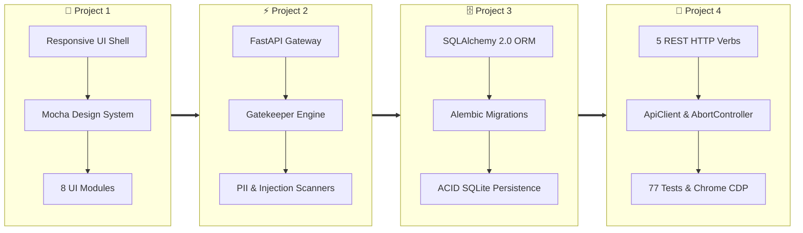
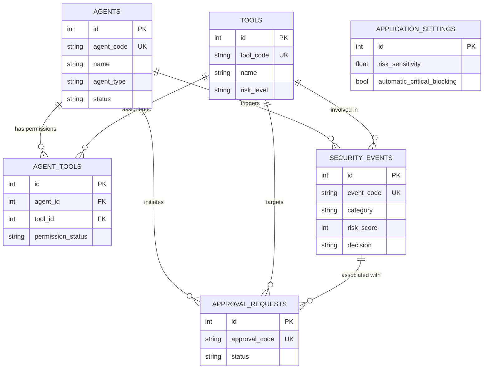

# Shield AI — AI Agent Security Shield
**Secure Every Prompt. Control Every Action. Trust Every Agent.**

[](http://127.0.0.1:8000)
[](https://python.org)
[](https://fastapi.tiangolo.com)
[](https://sqlalchemy.org)
[-brightgreen?style=for-the-badge&logo=pytest)](http://127.0.0.1:8000)
[-blueviolet?style=for-the-badge&logo=googlechrome)](http://127.0.0.1:8000)

---

## ⚡ Single-Command Quick Start

You can launch the complete, unified full-stack application (frontend command center, FastAPI REST gateway, Gatekeeper policy engine, and SQLite relational persistence) with **one single command**:

```powershell
python run.py
```

*(On Windows, you can also double-click or run `.\run.bat`)*

### 🔍 What Happens Behind the Scenes in That Single Command:
1. **Database Auto-Initialization**: Automatically inspects the SQLite database (`data/shield_ai.db`), creates all six normalized relational tables if missing, and initializes default policy settings.
2. **FastAPI Gateway Launch**: Mounts all 10 REST API route controllers, Gatekeeper heuristic security engine, and CORS middleware on `http://127.0.0.1:8000`.
3. **Frontend Static Asset Serving**: Serves the mobile-first responsive HTML5/CSS3/Vanilla JS command center directly at the root URL.
4. **Interactive OpenAPI Specs**: Automatically provides Swagger UI at `/docs` and ReDoc at `/redoc`.

```
======================================================================
  SHIELD AI — AI AGENT SECURITY SHIELD
  Secure Every Prompt. Control Every Action. Trust Every Agent.
======================================================================
  Starting unified full-stack application on http://127.0.0.1:8000
  - Frontend Command Center:  http://127.0.0.1:8000
  - Interactive Swagger Docs: http://127.0.0.1:8000/docs
  - API Health Endpoint:      http://127.0.0.1:8000/api/health
  - Relational Database:      data/shield_ai.db (SQLite + SQLAlchemy 2.0)
======================================================================
```

---

## 🏛️ The Four Milestone Projects (Interactive Overview)

Shield AI was architected across four progressive development milestones in the **DecodeLabs Full Stack Development Internship (Batch 2026)**. Every milestone is preserved in its own dedicated directory with standalone code and an independent `README.md`:

```
shield-ai/
├── 📁 project-1/    ─── Milestone 1: Responsive Frontend Development
├── 📁 project-2/    ─── Milestone 2: Backend API Development & Integration
├── 📁 project-3/    ─── Milestone 3: Relational Database Integration & Persistence
├── 📁 project-4/    ─── Milestone 4: Complete Frontend & Backend Integration
└── 📦 shield-ai-final.zip  ─── Final Verified Universal Submission Deliverable
```



---

### 🎨 Project 1: Responsive Frontend Development
> 📂 **Location**: [`/project-1`](./project-1) &nbsp;|&nbsp; 📖 **Dedicated Guide**: [`project-1/README.md`](./project-1/README.md)

#### Detailed Explanation:
Project 1 established the client-side user experience and design language for Shield AI. The primary goal was to construct a mobile-first, high-performance web interface using vanilla web technologies without heavyweight JavaScript frameworks.

#### Key Architectural Highlights:
- **Semantic HTML5 Shell**: Structured using `<header>`, `<main>`, `<section>`, `<article>`, `<dialog>`, and `<aside>` for clean accessibility and screen-reader support.
- **Modern CSS3 Design System**:
  - **Mocha Mousse Design Tokens**: Primary Accent (`#A47864`), Ethereal Blue (`#A0D4E0`), Moonlit Grey canvas (`#F2F0EA`), Deep Ink typography (`#201E1F`).
  - **CSS Grid & Flexbox**: 2-dimensional grid for the KPI cards and tool permissions matrix; 1-dimensional flexbox for header controls and action button groups.
  - **Fluid Breakpoints**: Gracefully adapts across Mobile (320px), Tablet (768px), Laptop (1024px), and Desktop (1440px+).
- **The 8 Interactive Modules**:
  1. *Overview Dashboard*: Dynamic KPI metrics, risk distribution meters, and proportional SVG timeline.
  2. *Prompt Scanner*: Character counter, sample prompt library, and heuristic vulnerability alerts.
  3. *Agent Monitor*: Autonomous agent profiles, risk indicators, and multi-stage workflow telemetry.
  4. *Tool Permissions Matrix*: Natural tool toggle switches and granular status dropdowns.
  5. *Approval Center*: Human-in-the-loop review queue for elevated actions.
  6. *Threat Logs*: Filterable audit table supporting keyword, severity, and category filtering.
  7. *Attack Simulator*: Visual attack player with progressive stage animations.
  8. *Settings*: Security slider and system policy toggles.
- **Stand-alone Execution**: Can be run directly by opening `project-1/index.html` in any modern web browser or via `python -m http.server 8000`.

---

### ⚡ Project 2: Backend API Development & Integration
> 📂 **Location**: [`/project-2`](./project-2) &nbsp;|&nbsp; 📖 **Dedicated Guide**: [`project-2/README.md`](./project-2/README.md)

#### Detailed Explanation:
Project 2 introduced the backend application tier powered by **FastAPI** and **Pydantic v2**. It transformed the static frontend into an active security gateway governed by server-side policy enforcement.

#### Key Architectural Highlights:
- **The Gatekeeper Rule (*"Never Trust the Client"*):** All prompt inspection, tool policy verification, and permission checks are enforced strictly on the server.
- **Pydantic v2 Schema Validation:** Ensures input validation (`ScanRequest`, `ToolUpdate`, `ApprovalDecisionRequest`) and outbound serialization with field-level constraints.
- **Heuristic Security Engine:**
  - *Prompt Injection Detection*: Recognizes instruction overrides, system prompt exfiltration attempts, and jailbreak signatures.
  - *PII & Secret Masking*: Regex-based pattern recognition identifying email addresses, phone numbers, and API keys, replacing sensitive bytes with masked previews.
- **Policy Hierarchy Engine:** Enforces the *"strictest policy wins"* rule where tool restrictions and sensitivity multipliers govern agent action approvals.
- **Standard Gatekeeper Error Contract:** Returns clean, structured JSON errors (`INVALID_INPUT`, `AGENT_NOT_FOUND`, `APPROVAL_ALREADY_DECIDED`) with appropriate HTTP status codes (`400`, `404`, `409`, `422`, `500`) without exposing internal tracebacks.
- **Stand-alone Execution**: `cd project-2; uvicorn backend.app.main:app --port 8000`.

---

### 🗄️ Project 3: Relational Database Integration & Persistence
> 📂 **Location**: [`/project-3`](./project-3) &nbsp;|&nbsp; 📖 **Dedicated Guide**: [`project-3/README.md`](./project-3/README.md)

#### Detailed Explanation:
Project 3 established the persistence phase of full-stack engineering, replacing ephemeral in-memory state with an enterprise relational database managed through **SQLAlchemy 2.0 ORM**, **SQLite**, and **Alembic** database migrations.

#### The Four Architectural Pillars:
1. **Blueprint (Schema & 3NF Design):**
   - Six normalized tables: `agents`, `tools`, `agent_tools` (M:M junction), `security_events`, `approval_requests`, and `application_settings`.
   - Natural business identifiers (`agent_code`, `tool_code`, `event_code`, `approval_code`).
2. **Bridge (Integration & Connection):**
   - Centralized singleton engine (`connection.py`) with reusable session factory (`session.py`).
   - Configured with Write-Ahead Logging (`PRAGMA journal_mode=WAL;`) and foreign key enforcement (`PRAGMA foreign_keys=ON;`).
3. **Action (CRUD & RESTful Standards):**
   - Full CRUD operations implemented across all entities using clean repository patterns.
4. **Shield (Integrity & Security):**
   - Database-level `CHECK` constraints (e.g. `0 <= risk_score <= 100`, `0.1 <= risk_sensitivity <= 5.0`).
   - Referential integrity with cascading deletes for agent tools and `ON DELETE SET NULL` for historical audit trails.
   - Parameterized queries to eliminate SQL injection risks.



- **Alembic Versioning**: Full migration runner supporting `alembic upgrade head` and safe rollbacks (`alembic downgrade -1`).
- **Stand-alone Execution**: `cd project-3; alembic upgrade head; uvicorn backend.app.main:app --port 8000`.

---

### 🔄 Project 4: Complete Frontend and Backend Integration
> 📂 **Location**: [`/project-4`](./project-4) &nbsp;|&nbsp; 📖 **Dedicated Guide**: [`project-4/README.md`](./project-4/README.md)

#### Detailed Explanation:
Project 4 unified all previous layers into a single, seamless full-stack system. It introduced complete 5-verb REST HTTP method support, centralized asynchronous Fetch client orchestration, AbortController timeout and cancellation multiplexing, explicit JSON error detection, and complete end-to-end regression testing.

#### Key Architectural Highlights:
1. **Complete 5-Verb REST Support**:
   - `GET`: Queries dashboard metrics, agent profiles, tool catalog, approvals, events, and settings.
   - `POST`: Submits prompt scans, executes attack simulations, resolves approval requests, and resets demo state.
   - `PUT`: Full state replacement for tool permissions and global sensitivity settings.
   - `PATCH`: Granular partial updates for settings (`PATCH /api/settings`), tools (`PATCH /api/tools/{id}`), agents (`PATCH /api/agents/{id}`), and approvals (`PATCH /api/approvals/{id}`).
   - `DELETE`: Event purge returning **`HTTP 204 No Content`** with empty body (`DELETE /api/events/{id}/purge`).
2. **Centralized REST API Client (`js/api.js`)**:
   - **AbortController Multiplexing**: Seamlessly multiplexes external user cancellation (e.g. rapid debounced typing) with internal 15s request timeouts onto an internal controller.
   - **Accurate Error Discrimination**: Intentional cancellations throw an `AbortError` (`isCancelled = true`, `code = "REQUEST_CANCELLED"`) without ever misclassifying as timeouts. Genuine timeouts report `TimeoutError` (`isTimeout = true`, `code = "REQUEST_TIMEOUT"`).
   - **Guaranteed `try...finally` Cleanup**: Ensures timeout timers (`clearTimeout`) and external abort event listeners (`removeEventListener`) are freed in `finally` blocks across all execution paths, including circular JSON serialization failures, network drops, and cancellations.
   - **Explicit JSON Body Parsing**: Server responses declaring `application/json` or `+json` with invalid syntax explicitly throw a structured `MALFORMED_JSON` error with HTTP status preserved. Genuinely empty bodies and `HTTP 204` cleanly return `null`.
3. **Defensive UI State Management (`js/app.js`)**:
   - Guaranteed button re-enabling in `finally` blocks across all user actions (`scan()`, `runSim()`, `updateToolPermission()`, `decideApprovalAction()`, `applySettings()`).
   - Concurrent initial data fetching via `Promise.allSettled()`.
   - Strict XSS protection via contextual HTML escaping (`esc()`).
4. **CORS & Preflight Handling**:
   - Configured FastAPI `CORSMiddleware` supporting `GET, POST, PUT, PATCH, DELETE, OPTIONS` and handling browser preflight requests across standard development ports (`:3000`, `:5173`, `:5500`, `:8000`, `:8080`).
5. **Universal ZIP Submission Packaging**:
   - Generates `shield-ai-final.zip` with **100% POSIX forward slashes (`/`)**, ensuring seamless extraction across Windows, Linux (Ubuntu, Debian, Fedora), and macOS.

---

## 🧪 Comprehensive Automated Testing (77 Tests, 100% Pass)

The application includes two automated test suites covering both the Python backend and the JavaScript client, plus automated real-browser Chrome DevTools Protocol verification:

### 1. Backend Pytest Suite (60 Tests)
```powershell
python -m pytest backend/tests -v
```
- `test_fullstack_integration.py`: CORS headers, preflight OPTIONS for PATCH, 8-module end-to-end flow, Gatekeeper error status codes, 5 REST HTTP methods (GET, POST, PUT, PATCH, DELETE), HTTP 204 No Content, and malformed JSON payloads — **6 PASSED**
- `test_migrations.py`: Fresh DB creation, rollback & re-upgrade, Project 2 data preservation, constraints — **4 PASSED**
- `test_models_and_schema.py`: CHECK constraints, foreign key referential integrity, UNIQUE natural keys — **5 PASSED**
- `test_crud_operations.py`: Full CRUD across Agents, Tools, AgentTools, Events, Approvals — **5 PASSED**
- `test_relationships.py`: 1:M cascades, M:M junction tables, cascade deletes — **3 PASSED**
- `test_sql_injection.py`: Parameterized query safety on searches and inserts — **2 PASSED**
- `test_scanner.py`, `test_approvals.py`, `test_simulator.py`, `test_permissions.py`, `test_events.py`, `test_persistence.py`, `test_health.py`, `test_integration.py` — **35 PASSED**
> **Backend Result**: `60 passed in 5.36s (100% pass rate)`

### 2. Frontend API Client Test Suite (17 Tests)
```powershell
node --test tests/test_api_client.js
```
- `AbortController Multiplexing`: External cancellation before dispatch & during execution — **PASSED**
- `Timeout Enforcement`: Request timeout triggers accurately with and without external signals — **PASSED**
- `Resource Cleanup`: Spies verify timer clearance and listener removal across success, failure, and timeout — **PASSED**
- `Circular JSON Handling`: Guaranteed cleanup in `finally` when `JSON.stringify` throws a circular error — **PASSED**
- `Explicit JSON Validation`: Raises `MALFORMED_JSON` on corrupted application/json responses while preserving HTTP status — **PASSED**
- `HTTP 204 & Empty Bodies`: Safely returns `null` without throwing unexpected JSON EOF errors — **PASSED**
- `Legitimate Plain Text`: Successfully parses non-JSON text/plain payloads — **PASSED**
> **Frontend Result**: `17 passed in 400ms (100% pass rate)`

### 3. Automated Browser Verification (Google Chrome CDP)
```powershell
node scripts/browser_verify.js
```
- Drives real headless Google Chrome (`Chrome/156`) via native Chrome DevTools Protocol (CDP).
- Exercises all 8 interactive modules, tab transitions, scans, simulations, and settings.
- Verifies **0 console errors**, **0 unhandled Promise rejections**, **0 stuck loaders**, and **0 permanently disabled buttons**.

---

## 📁 Repository Directory Structure

```
shield-ai/
├── run.py                          # ⚡ Single-command launcher (python run.py)
├── run.bat                         # Windows one-click batch launcher
├── index.html                      # Semantic HTML5 shell and 8 modular views
├── css/
│   ├── style.css                   # Mobile-first design system, design tokens, interactive states
│   └── responsive.css              # Fluid layout breakpoints (320px to 1440px+)
├── js/
│   ├── api.js                      # Centralized REST API client (5 verbs, AbortController, JSON validation)
│   └── app.js                      # Asynchronous UI controller, DOM manipulation, state management
├── backend/
│   ├── requirements.txt            # Backend dependencies (FastAPI, SQLAlchemy, Alembic)
│   ├── migrations/                 # Alembic migration revisions
│   │   ├── env.py                  # Dynamic DB connection runner
│   │   └── versions/               # Schema evolution migration scripts
│   ├── app/
│   │   ├── main.py                 # FastAPI entrypoint, CORS middleware, static mounting
│   │   ├── exceptions.py           # Gatekeeper standard error handling
│   │   ├── database/               # SQLAlchemy 2.0 shared engine & session factory
│   │   ├── models/                 # SQLAlchemy ORM Relational Models (6 tables)
│   │   ├── schemas/                # Pydantic Validation & Serialization Schemas
│   │   ├── repositories/           # SQLAlchemy 2.0 Data Access Repositories
│   │   ├── routes/                 # REST API Route Controllers (GET, POST, PUT, PATCH, DELETE)
│   │   └── services/               # Heuristic security & policy evaluation engines
│   └── tests/                      # Pytest Automated Test Suite (60 Tests)
├── tests/
│   └── test_api_client.js          # Frontend API Client regression tests (17 Tests)
├── scripts/
│   ├── browser_verify.js           # Automated Chrome CDP end-to-end verification
│   ├── package_and_validate.py     # Universal ZIP packaging & CRC32 validator
│   └── setup_projects.py           # Milestone project synchronization script
├── data/
│   └── shield_ai.db                # Persistent SQLite database (normalized 3NF)
├── alembic.ini                     # Alembic migration configuration
├── shield-ai-final.zip             # 📦 Final Universal Submission Archive (POSIX forward slashes)
│
├── project-1/                      # 🎨 Milestone 1: Responsive Frontend Development
│   ├── README.md                   # Dedicated Project 1 Guide
│   ├── index.html, css/, js/       # Complete frontend codebase
│   └── screenshots/                # Verified responsive captures (320px to 1440px+)
├── project-2/                      # ⚡ Milestone 2: Backend API Development
│   ├── README.md                   # Dedicated Project 2 Guide
│   ├── backend/ (FastAPI app)      # REST controllers & Pydantic schemas
│   └── index.html, css/, js/       # Integrated client
├── project-3/                      # 🗄️ Milestone 3: Database Integration
│   ├── README.md                   # Dedicated Project 3 Guide (ER Diagram & 4 Pillars)
│   ├── backend/ (SQLAlchemy ORM)   # 6 relational models & Alembic migrations
│   └── data/ (shield_ai.db)        # Normalized 3NF SQLite database
└── project-4/                      # 🔄 Milestone 4: Full-Stack Integration
    ├── README.md                   # Dedicated Project 4 Guide
    ├── shield-ai-final.zip         # Final Submission Archive copy
    └── backend/, tests/, scripts/  # Full-stack engine and regression suites
```

---

## 🛠️ Complete Verification & Run Commands Summary

| Task | Single Command | Description |
|---|---|---|
| **Run Entire Full-Stack App** | `python run.py` | Auto-initializes database, mounts REST gateway, and serves frontend on `http://127.0.0.1:8000` |
| **Run Pytest Backend Suite** | `python -m pytest backend/tests -v` | Runs all 60 Python backend tests (100% pass) |
| **Run Frontend API Tests** | `node --test tests/test_api_client.js` | Runs all 17 Node.js client tests (100% pass) |
| **Check JavaScript Syntax** | `node --check js/api.js; node --check js/app.js` | Validates JavaScript syntax with zero errors |
| **Run Chrome CDP Browser Test** | `node scripts/browser_verify.js` | Automated end-to-end browser verification via Chrome DevTools Protocol |
| **Package & Validate Final ZIP** | `python scripts/package_and_validate.py` | Rebuilds and validates `shield-ai-final.zip` with POSIX forward slashes |

---

## 📄 License & Attribution

Developed for the **DecodeLabs Full Stack Development Industrial Training Internship (Batch 2026)**.  
*All rights reserved.*
