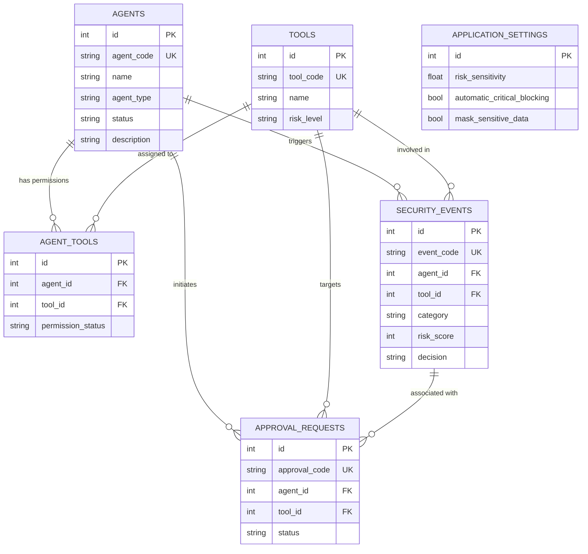

# Shield AI — Project 3: Relational Database Integration & Persistence
**DecodeLabs Full Stack Development Internship — Batch 2026**

> **Tagline**: Secure Every Prompt. Control Every Action. Trust Every Agent.

---

## 1. Project Overview

**Project 3** represents the persistence phase of full-stack development. It replaces ephemeral in-memory state with an enterprise relational database architecture built using **SQLAlchemy 2.0 ORM**, **SQLite**, and **Alembic** schema migrations.

---

## 2. The Four Architectural Pillars

1. **Blueprint (Schema & Design)**:
   - Six normalized 3NF relational models with natural identifiers (`agent_code`, `tool_code`, `event_code`, `approval_code`).
   - Many-to-many junction model `agent_tools` linking agents to their assigned tool permission configurations.
2. **Bridge (Integration & Connection)**:
   - Centralized singleton engine (`connection.py`) with reusable session factory (`session.py`).
   - Avoids per-request engine construction overhead; enforces WAL journaling and `PRAGMA foreign_keys = ON;`.
3. **Action (CRUD & RESTful Standards)**:
   - Full CRUD operations implemented for all models through dedicated repository patterns (`agent_repo.py`, `tool_repo.py`, `event_repo.py`, `approval_repo.py`, `settings_repo.py`).
4. **Shield (Integrity & Security)**:
   - Database-level `CHECK` constraints (e.g. `0 <= risk_score <= 100`, `0.1 <= risk_sensitivity <= 5.0`).
   - Foreign keys with strict deletion cascade policies (`ON DELETE CASCADE` for agent tools; `ON DELETE SET NULL` for audit trails).
   - Parameterized queries throughout ORM queries to prevent SQL injection vulnerabilities.

---

## 3. Database Schema Specification



---

## 4. Alembic Database Migrations

Database schema versioning is managed via Alembic:

```powershell
# Run all migrations up to head
alembic upgrade head

# Roll back one migration step
alembic downgrade -1
```

Migration script `backend/migrations/versions/c569f299eaed_create_project3_relational_schema.py` provides deterministic schema creation with backward-compatible legacy Project 2 data preservation.

---

## 5. How to Run & Test Project 3

### Step 1: Install Dependencies
```powershell
pip install -r backend/requirements.txt
```

### Step 2: Apply Database Migrations
```powershell
alembic upgrade head
```

### Step 3: Run Database & Migration Tests
```powershell
python -m pytest backend/tests/test_migrations.py backend/tests/test_crud_operations.py backend/tests/test_relationships.py -v
```

### Step 4: Start Application
```powershell
uvicorn backend.app.main:app --host 127.0.0.1 --port 8000
```

